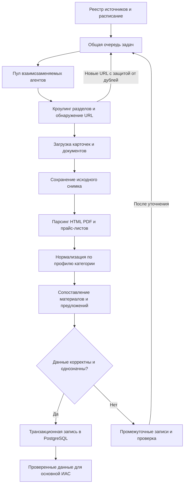
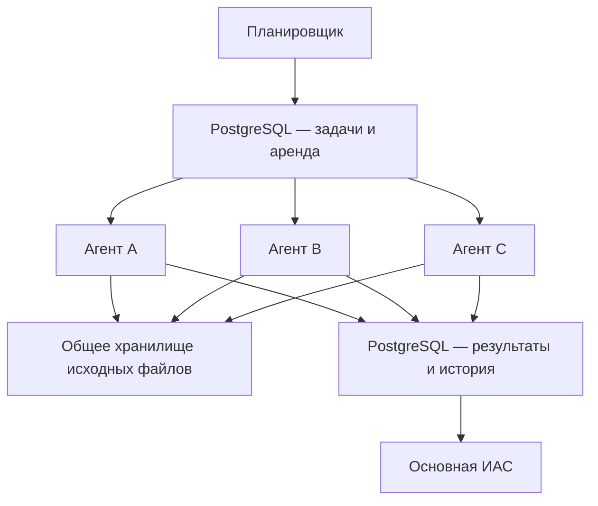
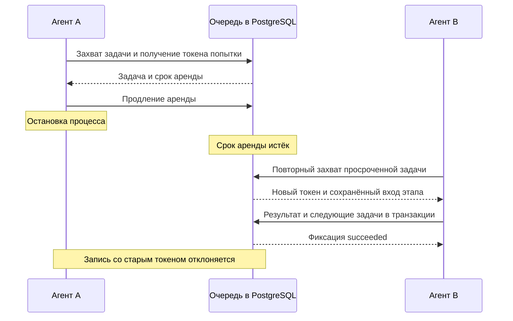
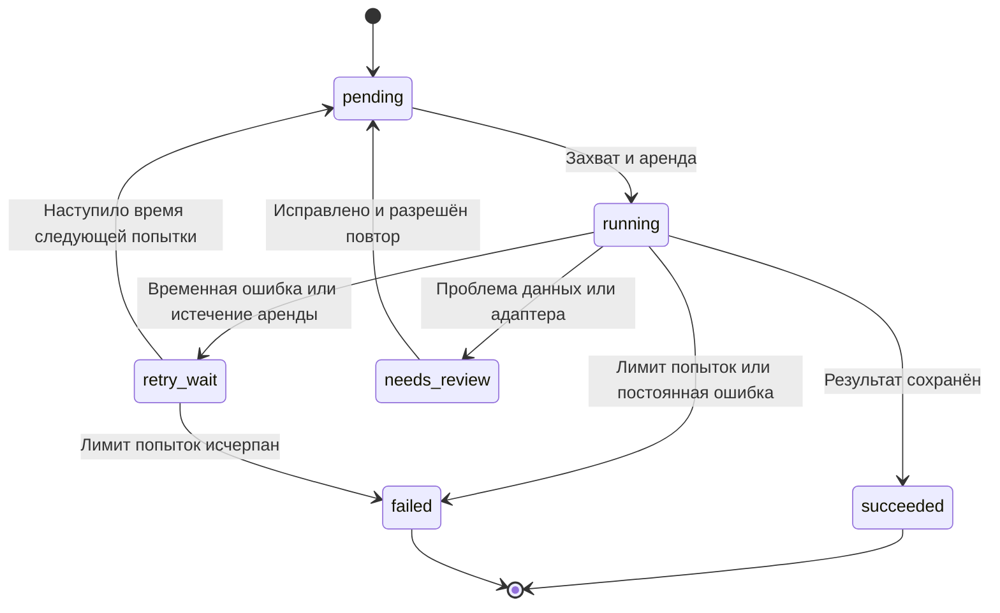

# Materials Data Pipeline

Многоагентная подсистема сбора и подготовки данных для проекта **«Разработка ИАС анализа строительных материалов и подбора функциональных аналогов»**.

Проект получает сведения из каталогов производителей, технических документов и предложений поставщиков, приводит их к единой структуре и сохраняет в PostgreSQL. Подготовленные данные используются основной ИАС для поиска возможных замен с учётом ограничений, оценки компромиссов между стоимостью и характеристиками и расчёта влияния замены на бюджет.

## Назначение

Технические характеристики и цены распределены по разным источникам. Названия, единицы измерения и упаковки различаются, а коммерческие условия меняются. Подсистема должна подготовить сопоставимые записи и сохранить основания каждого значения.

Основные задачи:

- обнаруживать карточки и документы в заданных разделах сайтов;
- извлекать назначения, технические характеристики, размеры, фасовки, цены и условия поставки;
- различать материал, конкретное исполнение и предложение поставщика;
- нормализовать единицы и названия показателей;
- выявлять дубли, конфликты и неполные записи;
- сохранять источник, время получения и историю изменений;
- продолжать обработку после остановки одного из агентов.

Подбор функциональных аналогов, техническое согласование замены и ранжирование вариантов закупки относятся к основной ИАС. Этот репозиторий отвечает за получение и качество исходных данных.

## Работа с разными категориями материалов

Подсистема не ограничивается одной группой продукции. Общие сведения описывают производителя, материал, исполнение, документы и предложения. Специфические характеристики задаются **профилем категории**.

| Категория | Примеры извлекаемых свойств |
| --- | --- |
| Кладочные материалы | Размеры, прочность, морозостойкость, плотность, пустотность |
| Сухие смеси и клеевые составы | Назначение, допустимые основания, расход, адгезия, толщина слоя |
| Теплоизоляционные материалы | Теплопроводность с условиями определения, размеры, водопоглощение, назначение |
| Кровельные и гидроизоляционные материалы | Тип, основа, толщина, размеры, ограничения применения |
| Листовые и отделочные материалы | Размеры, толщина, масса, влагостойкость, тип поверхности |
| Лакокрасочные материалы | Основание, расход, число слоёв, время высыхания, условия нанесения |

Профиль определяет набор полей, единицы, словари, типы значений и проверки. Подключение новой категории требует адаптеров источников и контрольных примеров, но не копирования всей подсистемы.

Сравнение выполняется с учётом категории и конкретного применения. Универсального набора технических показателей для всех материалов нет. Подсистема сохраняет данные для предметных правил основной ИАС; соответствие правилам качества данных не означает пригодность материала в любой конструкции.

## Связь данных с аналитикой основной ИАС

| Данные парсера | Для чего используются |
| --- | --- |
| Назначение, ограничения применения, технические показатели | Проверка кандидатов на функциональную замену |
| Сопоставимые характеристики и условия их определения | Анализ преимуществ и ограничений вариантов |
| Цена, фасовка, расход, единица продажи | Расчёт стоимости требуемого количества |
| Минимальная партия, наличие, сроки и доставка | Сравнение сценариев закупки |
| Источники, даты и статусы качества | Проверка оснований рекомендаций |

Например, у сухой смеси ниже цена за мешок, но больше расход на единицу площади. Сведения о фасовке, цене и расходе позволяют основной ИАС сравнить стоимость выполнения одинаковой задачи. Сам парсер не выбирает победителя и не согласовывает техническую замену.

## Что означает многоагентность

**Агент — самостоятельный процесс-исполнитель, а не обязательно нейросетевая модель.** Несколько экземпляров приложения независимо получают задачи из общей очереди. Каждый агент поддерживает набор возможностей: загрузка страниц, обход каталога, обработка HTML/PDF, нормализация и сохранение результатов.

Агенты не закрепляются навсегда за отдельным сайтом или этапом. Тип задачи определяет обработчик, а доступные возможности — какие агенты могут её выполнить. При отказе агента оставшуюся работу получает другой совместимый исполнитель.


## Общий пайплайн



Стрелки между этапами обозначают задачи и сохранённые результаты. Весь пайплайн не выполняется одной неделимой операцией: завершённые этапы имеют контрольные точки, от которых другой агент может продолжить работу.

## Архитектура

PostgreSQL используется для предметных данных, очереди и координации. Это для уменьшения числа компонентов, а не заявление о неограниченной производительности.



Исходные файлы должны быть доступны всем агентам: через общий том в локальной конфигурации или объектное хранилище при распределённом запуске. Локальный файл внутри единственного контейнера не является общей контрольной точкой.

## Этапы обработки

| Этап | Вход | Результат |
| --- | --- | --- |
| Планирование | Источники, расписание, параметры запуска | Задачи с уникальными ключами |
| Кроулинг | Начальные URL, разрешённые разделы | Карточки, документы, страницы пагинации |
| Загрузка | URL и политика доступа | Снимок, HTTP-метаданные, контрольная сумма |
| Парсинг | Снимок и версия адаптера | Поля и фрагменты-основания |
| Нормализация | Значения и профиль категории | Единицы, словари, типы ограничений |
| Сопоставление | Марка, артикул, размеры, упаковка | Связь с исполнением или запрос проверки |
| Валидация | Структурированная запись | Проверенная запись либо список проблем |
| Сохранение | Проверенный результат этапа | Запись в БД и следующие задачи |

Неполнота отдельной характеристики не обязательно блокирует сохранение всего материала. Запись сохраняется со статусом качества, а проверенный факт отделяется от предположения. Основная ИАС получает сведения о пропусках вместе с данными.

## Источники и адаптеры

Источники — каталоги производителей строительных материалов, технические паспорта и листы, каталоги продавцов, прайс-листы и предоставленные коммерческие предложения. Для каждого источника фиксируются категории продукции, доступные документы, региональные настройки и правила обновления. Конкретный сайт считается подключённым только после реализации и проверки адаптера.

Перед подключением проверяются доступность полей, правила использования, ограничения частоты и необходимость выбора региона. Если автоматический доступ недоступен, допускается импорт предоставленного файла. Система не предусматривает обход авторизации и защитных механизмов.

Каждый адаптер отвечает за один источник и должен определять:

- разрешённые адреса и способы обнаружения карточек;
- извлечение идентификаторов, полей и ссылок на документы;
- соответствие исходных названий общей схеме;
- признаки изменения структуры страницы;
- версию правил и контрольные примеры.

Политика запросов действует **на источник для всего пула**, а не только на отдельного агента. Увеличение числа процессов не должно увеличивать допустимую нагрузку на сайт. Проверяется также адрес назначения после перенаправления.

Для каждого запуска ограничиваются глубина обхода, число страниц, размер документов и время запроса. URL нормализуются по правилам источника: параметры региона или товарного исполнения нельзя удалять как «лишние» без проверки их смысла.

## Нормализация и сопоставление

Словарь категории связывает названия свойств с общими понятиями. Исходная формулировка сохраняется вместе с нормализованным значением, единицей, знаком ограничения и условиями определения. Показатели, измеренные при разных условиях, не признаются сопоставимыми автоматически.

Цена за килограмм не сравнивается с ценой за упаковку до определения массы упаковки. Пересчёт из массы в объём допустим только при наличии достоверного основания. Неизвестная стоимость доставки не записывается как ноль, отсутствие цены — как бесплатное предложение.

Для установления идентичности используются производитель, артикул и существенные признаки исполнения. В разных категориях это размеры, фасовка, марка прочности, покрытие или другие параметры. Неоднозначные совпадения направляются на проверку. Сопоставление карточки продавца с продукцией производителя не означает признание разных материалов функциональными аналогами.

## Какие данные сохраняются

| Сущность | Примеры полей |
| --- | --- |
| Категория и профиль | Свойства, единицы, словари, версия правил |
| Источник | Идентификатор, домен, категории, способ доступа, версия адаптера |
| Снимок | Исходный и конечный URL, время, статус, хеш, путь к файлу |
| Материал | Производитель, марка, категория, назначение |
| Исполнение | Артикул, размеры, фасовка и специфические признаки категории |
| Характеристика | Название, значение, единица, условие определения |
| Предложение | Поставщик, регион, исполнение, единица продажи |
| Наблюдение предложения | Цена, валюта, заявленное наличие, дата наблюдения |
| Условия поставки | Срок, минимальная партия, доставка, разгрузка, срок действия условий |
| Проблема качества | Тип, затронутое поле, основание, статус проверки |
| Задача | Этап, вход, состояние, владелец, попытка, срок аренды |

Технические свойства отделены от коммерческих условий. Одно исполнение может иметь несколько предложений. Изменение цены создаёт наблюдение, а не уничтожает историю.

Пример структуры извлечённого факта — **условные данные**, не сведения о реальном товаре:

```json
{
  "source_id": "manufacturer_demo",
  "source_url": "https://catalog.example.valid/product/demo",
  "snapshot_id": "snapshot-demo-001",
  "adapter_version": "0.1.0",
  "category_code": "masonry_materials",
  "attribute": "length",
  "raw_value": "250 мм",
  "value": "0.250",
  "unit": "m",
  "operator": "=",
  "measurement_condition": null,
  "quality_status": "needs_review",
  "evidence": "Фрагмент таблицы технического документа"
}
```

Структура факта едина для разных категорий, но перечень характеристик и проверок различается. Неизвестные условия и неподтверждённые значения отмечаются явно. Денежные и точные десятичные величины обрабатываются десятичными типами без потери точности двоичной арифметики.

## Как другой агент подхватывает работу

Задача передаётся агенту по **аренде на ограниченное время** (`lease`). Агент продлевает аренду сигналами активности. После истечения срока задачу можно назначить другому агенту.

1. Исполнитель атомарно выбирает подходящую задачу и устанавливает владельца, срок аренды и номер попытки.
2. Короткая транзакция захвата завершается. Сетевые запросы выполняются без длительного удержания блокировки строки.
3. Агент обрабатывает задачу, сохраняет промежуточные данные и продлевает аренду.
4. Перед финальной записью проверяются владелец, действующий срок и токен текущей попытки.
5. Результат, следующие задачи и состояние `succeeded` фиксируются одной транзакцией.
6. Любой работающий агент может вернуть задачу в обработку с новым токеном и увеличенным счётчиком попыток.

Для конкурирующего получения задач предполагается использовать `FOR UPDATE SKIP LOCKED`. Проверки владельца и токена выполняются в той же транзакции, что и итоговая запись. Старый агент, возобновивший работу после потери аренды, не должен перезаписать результат новой попытки.



Восстановление означает повторное выполнение незавершённого этапа от сохранённого входа. Состояние памяти упавшего процесса не переносится. Уже завершённые этапы не требуют повторной загрузки, если их снимки доступны и пригодны для продолжения.

## Состояния задач



Проверка истёкших аренд и перевод отложенных задач доступны нескольким агентам и выполняются атомарно. Единственный отдельный «агент восстановления» не должен становиться обязательной точкой отказа.

## Повторная обработка без дублей

Целевая модель — **выполнение не менее одного раза** (`at-least-once`) с идемпотентной записью. Повторный HTTP-запрос или запуск парсинга допустим; повторное создание одной и той же логической записи — нет.

| Объект | Основание защиты от дублей |
| --- | --- |
| Задание этапа | Источник, тип этапа, вход и идентификатор запуска |
| Снимок содержимого | Хеш содержимого и ссылка на наблюдение источника |
| Результат извлечения | Снимок, версия адаптера и версия схемы |
| Исполнение | Подтверждённая предметная идентичность, а не только название |
| Наблюдение цены | Предложение и идентификатор запланированного наблюдения |

Уникальные ограничения задаются в БД; `INSERT ... ON CONFLICT` применяется там, где определён корректный ключ. Предварительной проверки «есть ли запись» в приложении недостаточно при параллельной обработке.

Если агент завершился до фиксации транзакции, изменения откатываются, задача повторяется. Если фиксация состоялась, но ответ не был получен, повторный запуск обнаруживает сохранённый результат по ключу идемпотентности. Создание следующих задач в той же транзакции устраняет разрыв между сохранением результата и продолжением пайплайна.

## Ошибки и ограничения восстановления

| Ситуация | Предполагаемое поведение |
| --- | --- |
| Тайм-аут, временная сетевая ошибка | Повтор с увеличивающейся задержкой и случайной добавкой |
| HTTP 429 | Учёт `Retry-After` и общая пауза для источника |
| HTTP 401/403, закрытый доступ | Приостановка источника и проверка условий доступа |
| HTTP 404 | Фиксация недоступности URL без автоматического удаления материала |
| Изменение разметки | Сохранение снимка, `needs_review`, исправление адаптера |
| Неоднозначное исполнение | Промежуточная запись и ручная проверка |
| Сбой агента | Повтор незавершённой задачи после истечения аренды |
| Недоступность PostgreSQL | Пауза выдачи задач и повтор подключения без заявления об успехе |

Другой агент устраняет последствия остановки процесса, но не исправляет общий дефект кода или запрет доступа. Сохранённые результаты не теряются при условии работоспособности и сохранности общих хранилищ. Отказ самой БД требует отдельной стратегии резервирования; репликация агентов её не заменяет.

## Предлагаемый стек

| Компонент | Назначение |
| --- | --- |
| Python | Исполнители, адаптеры и обработка данных |
| HTTP-клиент и HTML-парсер | Загрузка и извлечение полей |
| Обработчик PDF | Извлечение текста и таблиц; OCR при необходимости |
| PostgreSQL | Предметные записи, очередь, аренда и история |
| Миграции БД | Управляемое изменение схемы |
| Docker Compose | Локальная БД, общий том и несколько агентов |

Нейросетевая модель не является обязательной частью многоагентности. Её можно добавить для извлечения сложных описаний, сохраняя фрагменты-основания и отдельный контроль качества.

## Предлагаемая структура репозитория

| Путь | Назначение |
| --- | --- |
| `src/materials_pipeline/agents/` | Цикл исполнителя и сигналы активности |
| `src/materials_pipeline/queue/` | Захват, аренда, повторы и идемпотентность |
| `src/materials_pipeline/crawling/` | Обнаружение URL и общие лимиты источников |
| `src/materials_pipeline/adapters/` | Правила конкретных источников |
| `src/materials_pipeline/parsing/` | HTML, PDF и импорт прайс-листов |
| `src/materials_pipeline/categories/` | Профили категорий и словари свойств |
| `src/materials_pipeline/normalization/` | Единицы и представление значений |
| `src/materials_pipeline/matching/` | Сопоставление материалов, исполнений и предложений |
| `src/materials_pipeline/validation/` | Проверки качества и конфликты |
| `src/materials_pipeline/storage/` | Транзакции и хранилище снимков |
| `config/sources/` | Описание источников без секретов |
| `migrations/` | Миграции очереди и предметной схемы |
| `tests/fixtures/` | Разрешённые контрольные примеры нескольких категорий |
| `tests/integration/` | БД, параллелизм и восстановление |

Это целевая структура, а не перечень уже существующих файлов. Исходные выгрузки, секреты, журналы и локальные тома не должны попадать в Git. В репозитории остаются код, примеры конфигурации, контрольные данные и документация для понимания и запуска проекта.

## Конфигурация и запуск

Команды запуска добавляются после реализации и проверки на чистом окружении. Пока порядок развёртывания следующий:

1. Настроить подключение к PostgreSQL и общее хранилище снимков.
2. Применить миграции.
3. Зарегистрировать категории и источник, проверить адаптер на сохранённых примерах.
4. Запустить минимум два агента с одинаковыми возможностями.
5. Создать небольшой запуск сбора и проверить прохождение этапов.
6. Проверить остановку агента до включения регулярного расписания.

Проектируемые настройки:

| Параметр | Смысл |
| --- | --- |
| `DATABASE_URL` | Подключение к БД; секрет хранится вне Git |
| `AGENT_ID` | Уникальный идентификатор экземпляра |
| `AGENT_CAPABILITIES` | Поддерживаемые типы задач |
| `LEASE_SECONDS` | Срок аренды одной задачи |
| `HEARTBEAT_SECONDS` | Интервал продления, существенно меньше срока аренды |
| `MAX_ATTEMPTS` | Общий лимит попыток, включая восстановление после сбоев |
| `RAW_STORAGE_URI` | Общее хранилище исходных данных |
| `SOURCE_CONFIG_PATH` | Путь к описанию источников |
| `CATEGORY_CONFIG_PATH` | Путь к профилям категорий |

Сроки аренды проверяются по времени БД. Долгая задача должна продлевать аренду; истечение аренды само по себе не означает, что процесс остановлен. Поэтому защита финальной записи токеном обязательна.

## Проверка качества данных

- Сверить извлечённые характеристики с карточками и документами нескольких категорий.
- Проверить единицы, знаки ограничений и условия определения показателей.
- Проверить разделение материала, исполнения и предложения поставщика.
- Убедиться, что конфликты и пропуски доходят до основной ИАС со статусами качества.
- Повторить обработку того же снимка и проверить отсутствие дубликатов.
- Проверить историю цен и сохранение происхождения каждого факта.

## Наблюдаемость

В журнале фиксируются `run_id`, `task_id`, `agent_id`, тип этапа, источник, номер попытки, длительность и категория ошибки. Секреты подключения и лишние персональные данные не журналируются.

Основные показатели: число ожидающих и просроченных задач, возраст самой старой задачи, активные агенты, частота повторов, доля успешного извлечения, проблемы качества и актуальность последнего успешного обновления каждого источника.

## План реализации

- [ ] Общая схема данных, профили категорий и миграции.
- [ ] Очередь с атомарным захватом, арендой и токеном попытки.
- [ ] Два взаимозаменяемых агента и проверка принудительного сбоя.
- [ ] Первый адаптер и общее хранилище снимков.
- [ ] Парсинг, нормализация и предметная проверка первой категории.
- [ ] Дополнительная категория с собственными свойствами и проверками.
- [ ] Идемпотентная запись и транзакционное создание следующих задач.
- [ ] История предложений и контроль актуальности.
- [ ] Второй источник и сопоставление исполнений.
- [ ] Проверенные команды запуска и пример конфигурации.

Добавление категории проверяет расширяемость. Оно не означает автоматическую поддержку всех строительных материалов: для каждой группы требуются источники, профиль и примеры проверки.
