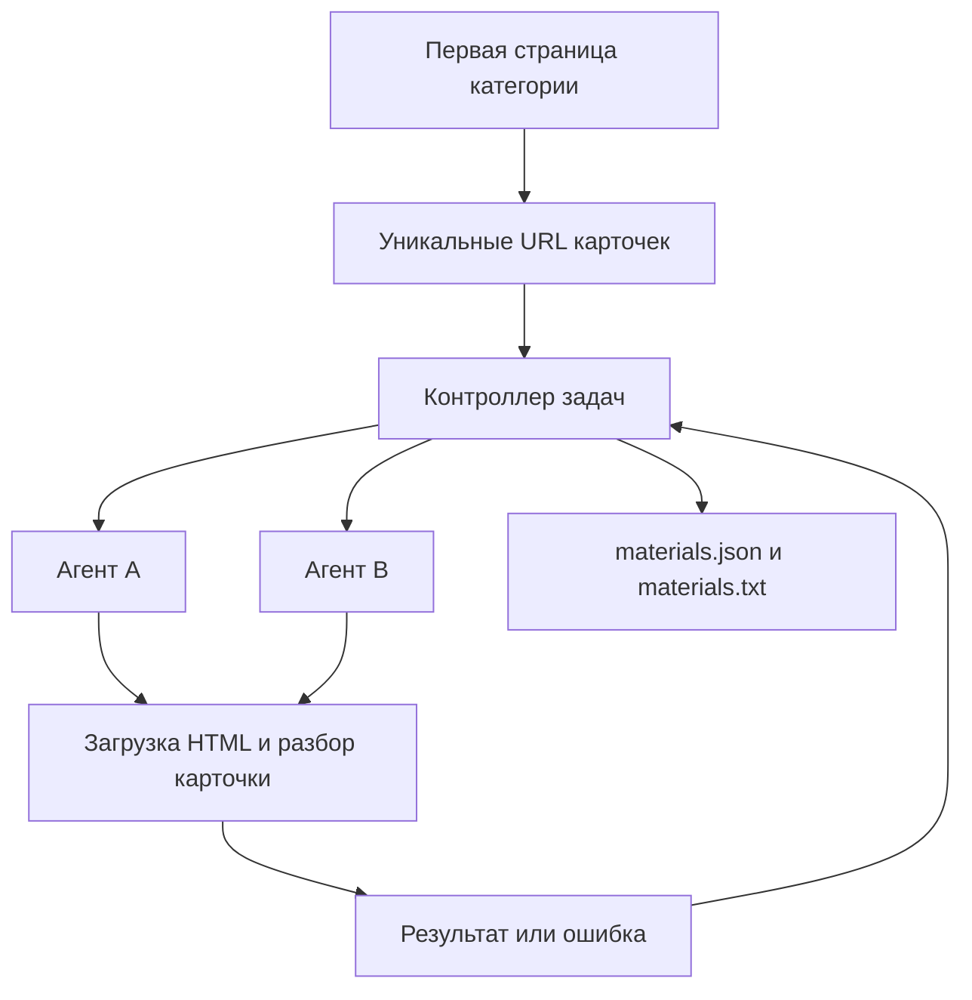

# Первый адаптер сбора строительных материалов

Рабочий пример для каталога ТЕХНОНИКОЛЬ: обнаружение карточек на первой странице раздела, обработка двумя процессами-агентами и сохранение JSON/TXT. По умолчанию собирается раздел **«Монтажные пены»**. Это одна демонстрационная категория, а не ограничение темы ИАС.

## Запуск в Windows

Установите Python 3.10 или новее. Распакуйте архив, откройте папку в VS Code и запустите терминал PowerShell:

```powershell
# Создание окружения
py -m venv .venv

# Установка единственной внешней зависимости
.\.venv\Scripts\python.exe -m pip install -r requirements.txt

# Сбор пяти карточек двумя агентами
.\.venv\Scripts\python.exe parser.py --limit 5 --agents 2
```

Активация окружения не требуется: команды используют его Python напрямую. Если команда `py` отсутствует, при создании окружения используйте `python -m venv .venv`.

Результат появится в папке `output`:

- `materials.json` — данные и ошибки в машиночитаемом виде;
- `materials.txt` — текст для просмотра;
- `html_cache/` — исходные HTML и служебный ограничитель запросов SQLite.

В архив включён результат реального контрольного сбора пяти карточек в `sample_output/`. Его можно открыть без запуска программы. HTML-кеш не включён.

## Что извлекается

- Название, производитель, категория и адрес карточки.
- Описание материала.
- Таблицы технических и логистических характеристик.
- Единицы, критерии «не менее / не более», значения и методы испытаний — как указано в источнике.
- Ссылки на PDF-документы и отдельный интернет-магазин.
- Время обработки, контрольная сумма HTML и признак чтения из кеша.

`price` и `currency` остаются `null`: коммерческие цены отдельного интернет-магазина эта версия не собирает. PDF не скачиваются и не разбираются. Числа и единицы технических таблиц сохраняются в исходном виде: предметная нормализация — следующий этап.

## Параметры

```powershell
# Больше карточек первой страницы, другая папка результатов
.\.venv\Scripts\python.exe parser.py --limit 10 --out data

# Повторное получение страниц с сайта вместо чтения кеша
.\.venv\Scripts\python.exe parser.py --refresh

# Последовательная обработка одним агентом
.\.venv\Scripts\python.exe parser.py --agents 1

# Справка
.\.venv\Scripts\python.exe parser.py --help
```

`--limit` задаёт верхнюю границу: если на первой странице меньше товаров, результат будет меньше. Обход пагинации намеренно не включён. Параметр `--category` принимает URL другого раздела `https://www.tn.ru/catalogue/.../`, но работа зависит от наличия той же HTML-разметки и таблиц; универсальная поддержка других категорий не заявляется.

Дополнительные настройки: `--delay` (общий интервал между запросами, по умолчанию 2 секунды), `--timeout` (сетевой тайм-аут, 30 секунд), `--task-timeout` (предельное время задачи, 90 секунд), `--attempts` (всего попыток на карточку, 2).

## Пайплайн



## Подхват задач

Это минимальная локальная многоагентная реализация. Основной процесс хранит очередь и знает текущую задачу каждого агента. Если дочерний процесс аварийно завершается или превышает время задачи, контроллер останавливает его, возвращает задачу в очередь и создаёт замену. Свободный агент получает повторную задачу в пределах лимита попыток.

В общий файл записывает только контроллер. JSON заменяется атомарно после каждого результата; ошибки включаются в отчёт. Запросы ограничены суммарно для агентов через маленькую SQLite-базу, которая служит только для интервалов запросов и не хранит каталог материалов. Снимки HTML доступны всем процессам в одной папке.

При аварии самого контроллера завершённые записи остаются в JSON, но автоматического продолжения очереди с прежнего места нет. Новый запуск использует HTML-кеш, заново формирует выборку и заменяет выходные файлы. Используйте другую папку `--out`, чтобы сохранить предыдущий сбор. Это ещё не распределённая очередь с арендой задач, описанная в архитектурном README.

## Проверка

```powershell
.\.venv\Scripts\python.exe -m unittest discover -s tests -v
```

Проверяются извлечение характеристик и документов, сохранение знака ограничения, отклонение пустой карточки и чужого домена. Отдельный тест действительно завершает дочерний процесс через `os._exit`, после чего контроллер переназначает задачу и сохраняет оба результата без дублей. Тесты не обращаются к сети.

## Ограничения

Адаптер проверен на пяти карточках монтажных пен. При изменении сайта селекторы могут потребовать исправления. Код отказывается принимать карточку без заголовка и таблиц характеристик, а не сохраняет её как успешный пустой материал. Сайт может отвечать медленно или ограничивать доступ; такие случаи отражаются как ошибки. Код завершения 0 означает отсутствие ошибок карточек, 2 — частичный результат с ошибками.

Перед расширением регулярного сбора проверяйте условия доступа источника. Новые источники и категории подключаются отдельными адаптерами; база данных, нормализация и полноценное возобновление очереди добавляются следующими этапами.
